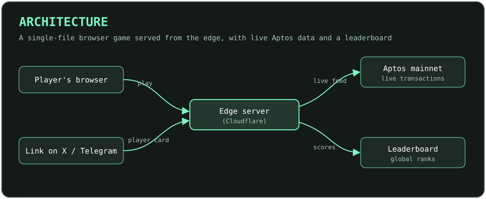

# Stacktos: Aptor's Ascent

**An Aptos Game.** A one-tap tower climber where Aptor stacks live Aptos transactions as blocks, climbing through six zones to the summit at height 470.

**Play:** coming soon

Stacktos is part of the **Bitcade** series of browser arcade games.

## How to play

Tap to drop the next block. Line it up with the one below to keep the tower straight; perfect drops build combos. Every block is a real, recent Aptos mainnet transaction: transfers, swaps, contract calls and more.

## The climb

| Zone | Starts at |
| --- | --- |
| Genesis | 0 |
| Mainnet | 60 |
| Parallel Heights | 144 |
| Block-STM Skies | 229 |
| Finality Orbit | 314 |
| Move Nebula | 412 |
| **Summit** | **470** |

| Title | Genesis | Mainnet |
| --- | --- | --- |
|  |  |  |

| Parallel Heights | Block-STM Skies | Finality Orbit | Move Nebula |
| --- | --- | --- | --- |
|  |  |  |  |

## Features

- **Intro cinematic** that sets up Aptor's ascent

  

- **Live Aptos data**: blocks are real mainnet transactions
- **Daily climb** with a shared challenge each day
- **Trophies** and **unlockables**
- **Aptos tips with sources** between runs
- **Global leaderboard**
- **Original soundtrack**, one theme per zone

## Soundtrack

- [Title](docs/music/00-title.mp3)
- [Genesis](docs/music/01-genesis.mp3)
- [Mainnet](docs/music/02-mainnet.mp3)
- [Parallel Heights](docs/music/03-parallel-heights.mp3)
- [Block-STM Skies](docs/music/04-block-stm-skies.mp3)
- [Finality Orbit](docs/music/05-finality-orbit.mp3)
- [Move Nebula](docs/music/06-move-nebula.mp3)
- [Build Complete](docs/music/07-build-complete.mp3)

## Architecture

## License

Copyright (c) 2026 Angel Fundora. All rights reserved. Source code is private.
See [LICENSE](LICENSE).
