# Stacktos: Aptor's Ascent

**An Aptos Game.** A one-tap tower climber where Aptor stacks live Aptos transactions as blocks, climbing through six zones to the summit at height 470. It's fun to play and built to teach: **50 Aptos tips** with official source links turn every run into a small lesson about the network.

**Status: launched** on October 16, 2026 (v1.25.0); latest update v1.26.0 on October 18, 2026. **[Play Stacktos](https://stacktos.bitcade.xyz)**

Stacktos is part of **Bitcade**, my series of browser arcade games.

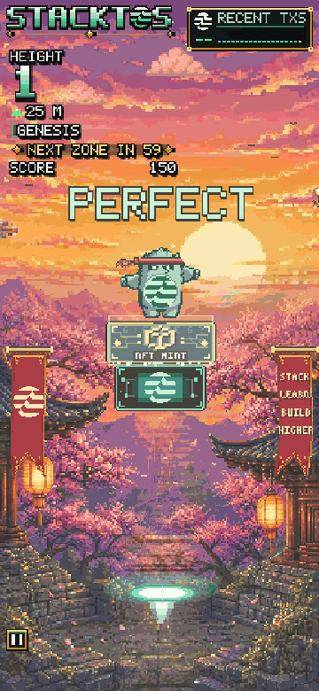

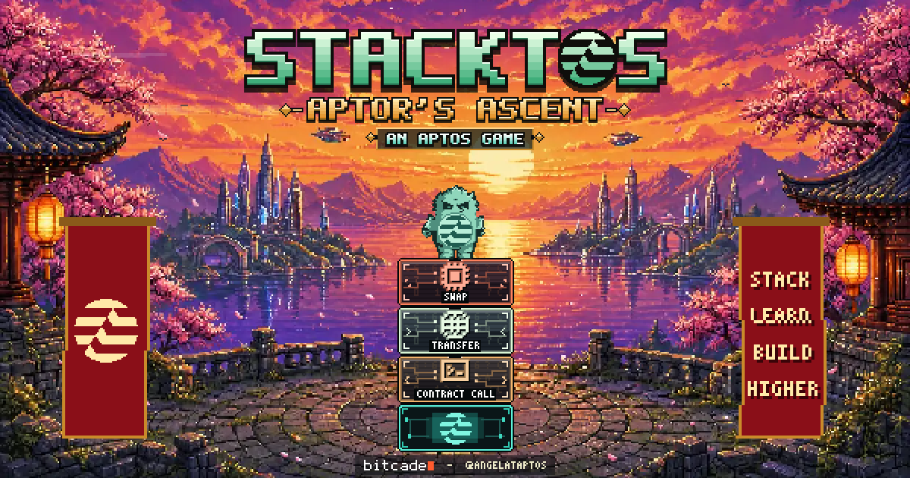

## Why I made it

I've been in crypto since early 2021, building communities and making games and tools for them. Explaining how a blockchain works is hard; playing with one is easy. Stacktos turns real Aptos mainnet transactions into the blocks you stack, so every run is a small, fun lesson about the network, with zones named after Aptos ideas like Block-STM, parallel execution and Move.

## Who it's for

Aptos community members and crypto-curious players who want a quick, one-tap game on their phone, and anyone who'd like to learn a little about Aptos along the way.

## Learn Aptos while you play

Between runs, Stacktos shows a short **Did you know?** tip about Aptos. Each tip has a **Source** link to an official Aptos doc or post, so you can dig deeper in one tap. See [all 50 tips with sources](TIPS.md). Tips are grouped by the same six climb zones, and the ones you see match the zone you reached.

Since v1.26.0 every tip is also an **Aptos card** to collect. The end of a run shows a card you haven't found yet from the zone you reached, with a **New card!** moment. The **Aptos cards** gallery (from **Cards** on the title screen or the trophies page) shows all 50: collected cards open their fact and official source, and locked cards stay as silhouettes until you find them.

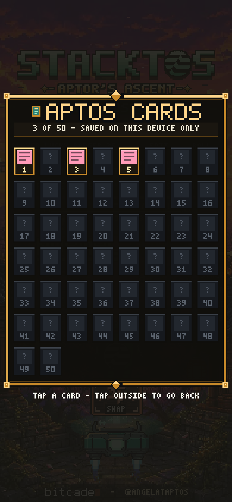

*As of October 15, 2026, from the v1.25.0 tip list in the game.*

| Zone | Tips | What you'll learn |
| --- | ---: | --- |
| **Genesis** | 9 | Mainnet launch and early validators; keyless accounts and key rotation; transaction versions; multisig; AIPs and on-chain governance; reading txs in the explorer |
| **Mainnet** | 9 | Native USDC and USDt; cross-chain USDC (CCTP); real payment and remittance apps (SpherePay, Yellow Card, Bitso, Coins.ph); sub-second settlement; sponsored gas; the fungible asset standard |
| **Parallel Heights** | 8 | Block-STM parallel execution (and why results stay correct); what gas pays for; typical fees; peak throughput and how Aptos scales; that your tower is built from real mainnet transactions |
| **Block-STM Skies** | 8 | Tokenized real-world assets on Aptos (BlackRock BUIDL, Franklin Templeton FOBXX, Ondo USDY); on-chain credit with PACT; funding and reporting loans in stablecoins |
| **Finality Orbit** | 8 | What finality means on Aptos; AptosBFT consensus; sub-second finality and the Baby Raptr upgrade; machine and agent payments with x402 (including HTTP 402 and sub-cent fees) |
| **Move Nebula** | 8 | The Move language and safe resources; on-chain modules and objects; the Move Prover; on-chain randomness; safe package upgrades; official SDKs (TypeScript, Python, Go, Rust) |
| **Total** | **50** | |

## The numbers

*As of October 16, 2026:* Stacktos had just launched at [stacktos.bitcade.xyz](https://stacktos.bitcade.xyz), so there are no player numbers yet. The launch build is **v1.25.0**, with **6 zones**, a summit at height **470**, **50 Aptos tips** with sources, and an **8-track original soundtrack**.

## How to play

A plasma launcher below the tower carries each new block back and forth. Tap to fire it up and land it on the tower under Aptor. Any overhang is trimmed off, so the tower narrows; land a block exactly for a **Perfect**; 3 Perfects in a row widen the block again. Perfect landings build combos, and 5 in a row triggers **Fever** for double Perfect bonuses. Miss the tower and the run is over. Every block is a real, recent Aptos mainnet transaction: transfers, swaps, contract calls and more, with gold blocks for stablecoin transfers and other highlighted transaction kinds.

## The climb

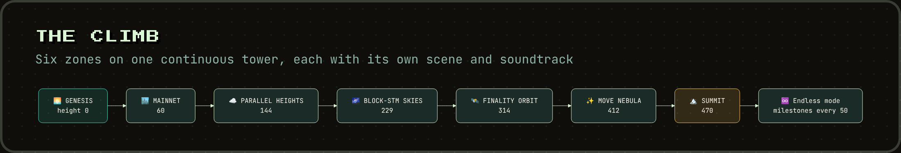

| Zone | Starts at |
| --- | --- |
| Genesis | 0 |
| Mainnet | 60 |
| Parallel Heights | 144 |
| Block-STM Skies | 229 |
| Finality Orbit | 314 |
| Move Nebula | 412 |
| **Summit** | **470** |

| Title | Genesis | Mainnet |
| --- | --- | --- |
| 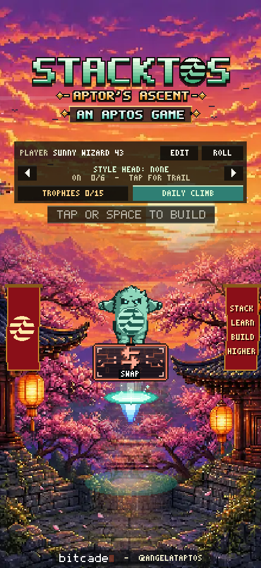 | 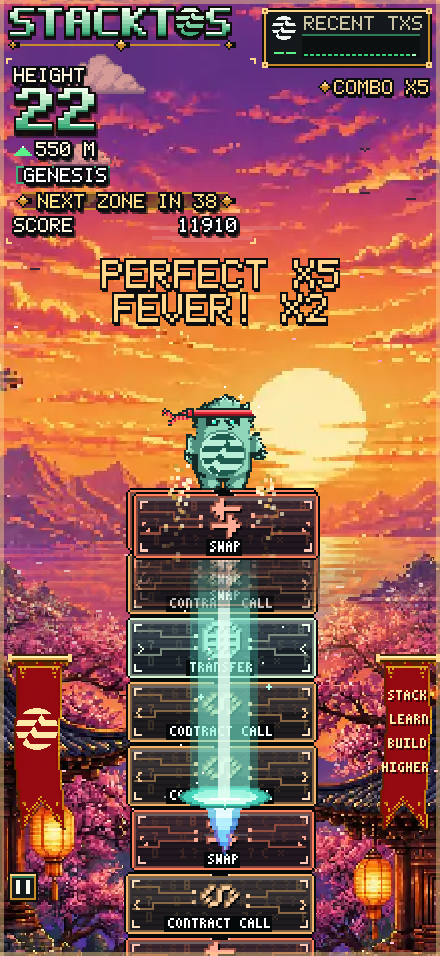 | 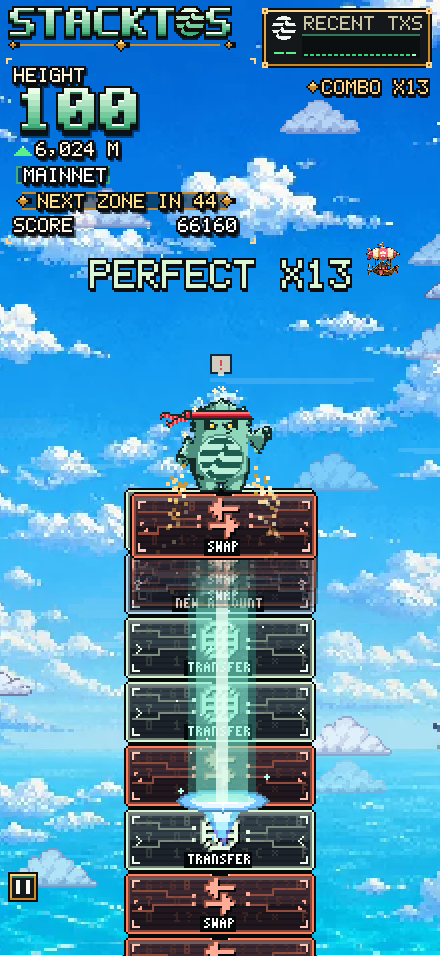 |

| Parallel Heights | Block-STM Skies | Finality Orbit | Move Nebula |
| --- | --- | --- | --- |
| 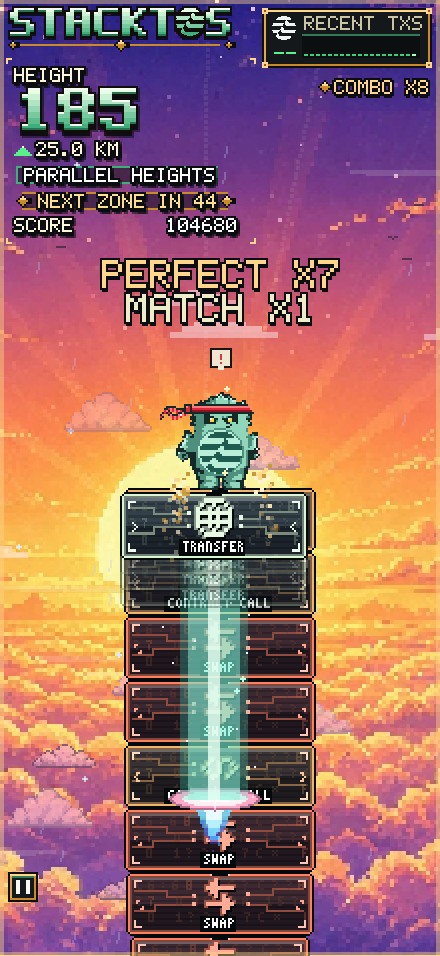 | 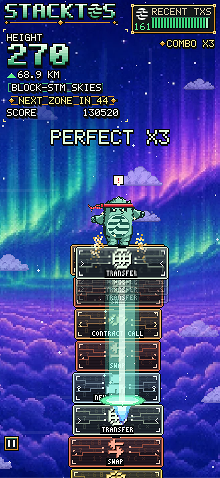 | 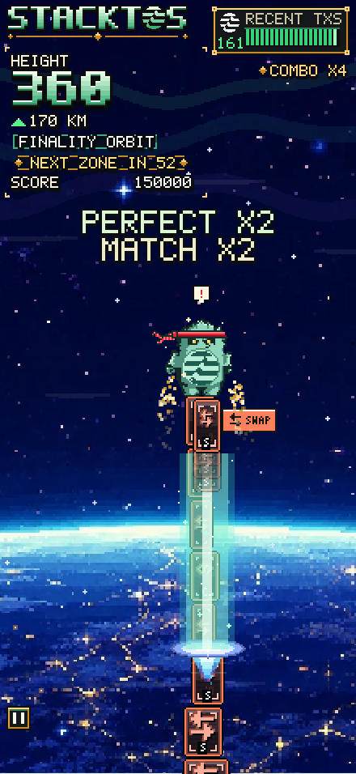 | 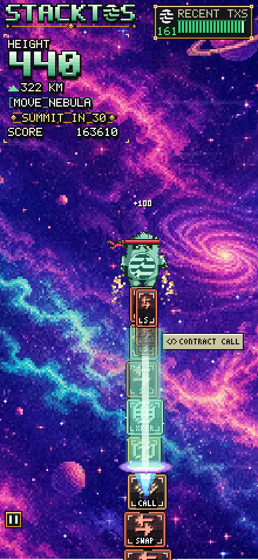 |

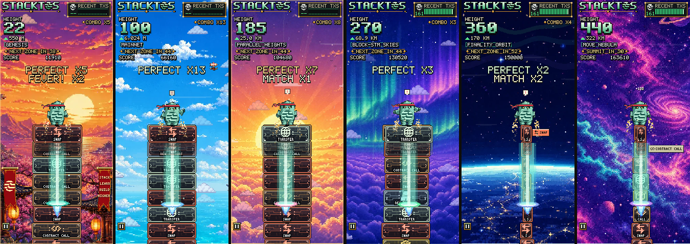

## Features

- **Intro cinematic** that sets up Aptor's ascent

  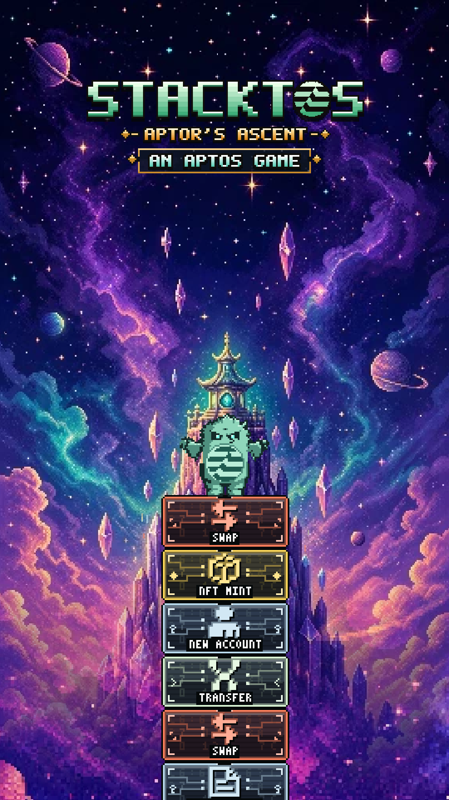

- **Real Aptos transactions**: every block is a recent mainnet transaction
- **50 Aptos tips with sources**, one short lesson between runs, collected as cards in the **Aptos cards** gallery
- **Trophies** and **unlockables**
- **Global leaderboard**
- **Original soundtrack**, one theme per zone

## Soundtrack

- [Title](docs/music/00-title.mp3)
- [Genesis](docs/music/01-genesis.mp3)
- [Mainnet](docs/music/02-mainnet.mp3)
- [Parallel Heights](docs/music/03-parallel-heights.mp3)
- [Block-STM Skies](docs/music/04-block-stm-skies.mp3)
- [Finality Orbit](docs/music/05-finality-orbit.mp3)
- [Move Nebula](docs/music/06-move-nebula.mp3)
- [Build Complete](docs/music/07-build-complete.mp3)

## Design decisions

- **Teach by playing.** A first run shows short hints right where you play instead of a tutorial screen.
- **One tap, phone first.** The whole game is a single input, so anyone can play in seconds.
- **Real data as the game.** Blocks are recent mainnet transactions, so the network itself becomes the level.
- **Learning without lecturing.** Fifty short Aptos tips, each with an official source, sit between runs and map to the zone you climbed.
- **Comeback mechanics.** Streaks of Perfect landings widen the block again, and a near miss can hang on as an edge catch, so skill is rewarded and runs stay tense.

## What I learned

- **Building on what Decicat taught me**: a phone-first, one-tap game that is quick to open from a post on X.
- **Building in public** with the X community and testing builds with players.
- **Iterating from feedback**: many versions so far, each one tightening feel and pacing.
- **Teaching Aptos through play**: turning real network facts into short, sourced tips players actually want to read.
- **Data accuracy**: showing real network activity faithfully, and checking every tip against its official source.
- **No sign-up**: open the link and play.

## License

Copyright (c) 2026 Angel Fundora. All rights reserved. Source code is private.
See [LICENSE](LICENSE).
